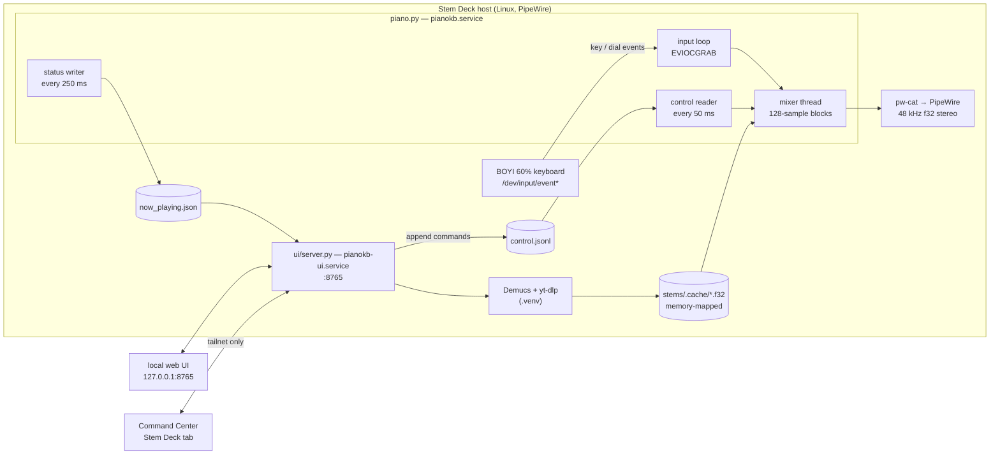
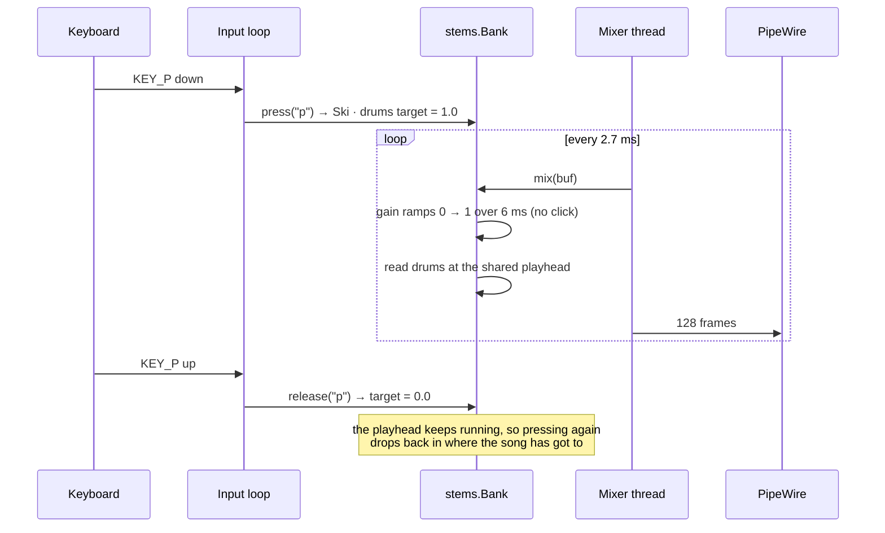
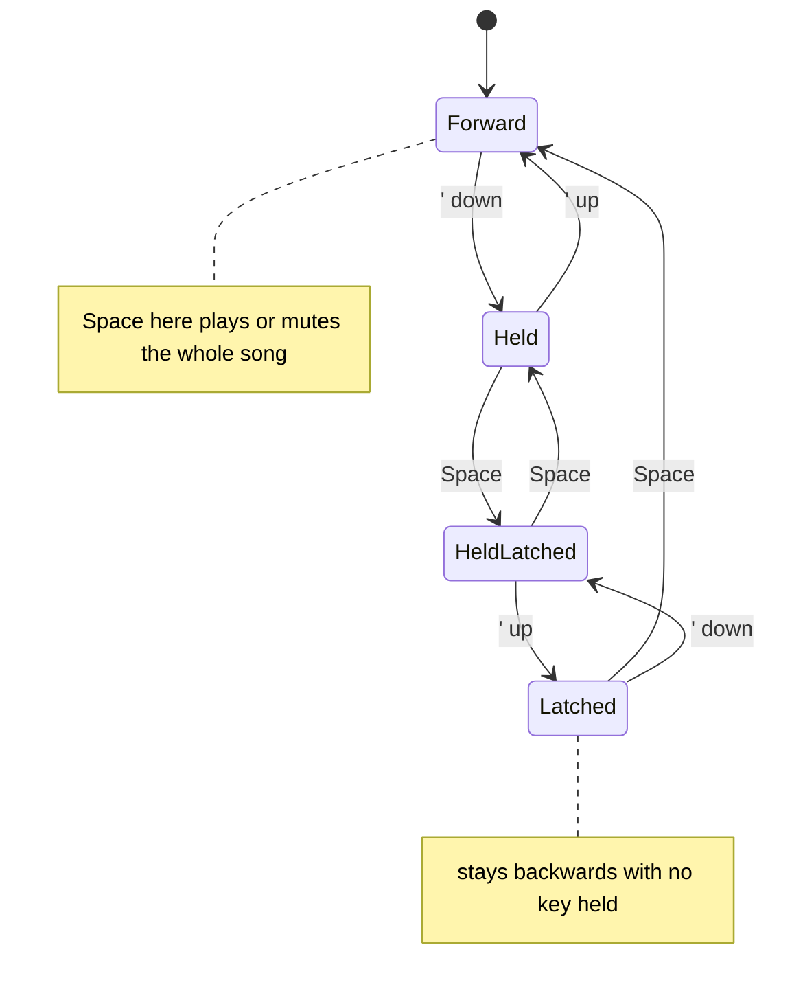
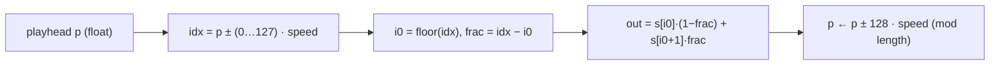

# How Stem Deck works

Three processes and two files carry everything. The engine owns the keyboard
and the audio; the UI server never touches either, it only reads a status file
and appends to a command file.

## The pieces



* **The keyboard is grabbed** (`EVIOCGRAB`), so its keys never reach the
  desktop. The engine waits for every key to be up before grabbing, because a
  key held during the grab would stay stuck for every keyboard on the system.
* **Audio is one raw stream** into `pw-cat` with a 10 ms PipeWire buffer and
  2.7 ms blocks, so a key press is heard after about 13 ms.
* **Stems are memory-mapped**: each file is converted once to raw 48 kHz stereo
  float32 in `stems/.cache/`, so a big library costs no RAM and no load time.
* **Processes talk through files.** The engine writes `now_playing.json`
  (atomically, with `os.replace`) and tails `control.jsonl`. The UI server
  never needs a socket into the engine, and a UI restart never interrupts
  playback.

## One key press, end to end



Every stem of a song reads from one shared playhead, so the parts stay
sample-locked no matter how they are gated.

## Reverse: hold, latch, release

The apostrophe key is momentary and Space latches it. The effective
direction is `held OR latched`.



Reversing does not jump anywhere: the playhead simply starts walking the other
way from where it is, so the reversed audio begins with what you just heard.
Piano notes started while reversed play tail first.

## The dial: tape speed

The BOYI knob is not a wheel. It sends **Volume Up / Volume Down** key presses
when turned and **Mute** when pressed, all on the keyboard interface the
engine has grabbed, so while Stem Deck runs the knob no longer changes the
system volume.

| dial | stems preset | piano / song presets |
| --- | --- | --- |
| turn | tape speed, 5% a notch, 0.50x – 2.00x | octave up / down |
| press | back to 1.00x if the speed moved, otherwise play / mute the whole song | same |

Speed is varispeed, like a turntable: pitch and tempo move together. At 1.00x
the mixer copies straight slices of the memmap; at any other speed it reads
fractional positions with linear interpolation:



Reverse and speed combine freely, so you can drag a song backwards at
half speed.

## Status and control files

`now_playing.json` (written every 250 ms):

```json
{
  "active": true, "preset": "Stems (7 songs)",
  "reverse": false, "reverse_held": false, "reverse_latched": false,
  "speed": 0.9, "last": 6,
  "song": "Ski", "playing": true, "position": 51.2, "duration": 152.0,
  "stems": [{"name": "vocals", "on": true}, "..."],
  "decks": [{"name": "20 Min", "playing": true, "position": 25.1, "duration": 220.6,
             "stems": [{"name": "vocals", "on": false, "key": "1"}, "..."]}, "..."]
}
```

`control.jsonl`: one JSON command per line, appended by the UI server. The
engine reads from its startup offset (old commands are never replayed), drops
anything older than 10 s, and rewinds when the UI truncates the file past
256 KB. See [`integrations/command-center`](../integrations/command-center/)
for the command list.

## Network exposure

The UI server binds `127.0.0.1` unless `PIANOKB_UI_HOST` says otherwise. To
reach it from another machine on a tailnet, add a drop-in:

```ini
# ~/.config/systemd/user/pianokb-ui.service.d/tailnet.conf
[Service]
Environment=PIANOKB_UI_HOST=0.0.0.0
```

Even then it answers only loopback and Tailscale addresses (`100.64.0.0/10`,
`fd7a:115c:a1e0::/48`) and returns 403 to everything else. There is no other
authentication, so do not port-forward it to the internet.
