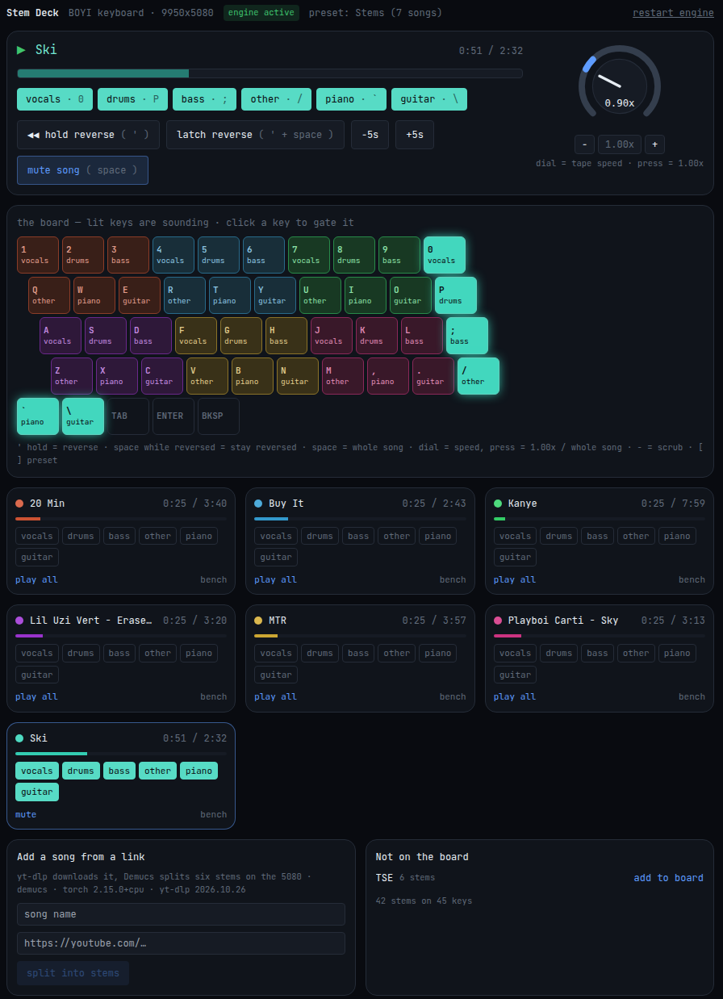

# Command Center integration — the Stem Deck tab

These two files are the dashboard that drives Stem Deck from a separate
"operations console" (Next.js + FastAPI) running on another machine. They are
copied here as a reference; they are not needed to run Stem Deck itself, which
has its own web UI on port 8765.



| file | goes in | what it does |
| --- | --- | --- |
| `stemdeck.py` | the FastAPI backend | `APIRouter` at `/api/stemdeck/*` that forwards to the Stem Deck UI server. Set `CMD_CENTER_STEMDECK_URL` to `http://<stem deck host>:8765`. |
| `StemDeckTab.tsx` | the Next.js frontend | the tab itself: now playing, hold/latch reverse, tape-speed knob, scrub and seek, live board map, per-song stem gates, bench, add-from-link |

## Routes

| console route | Stem Deck route | notes |
| --- | --- | --- |
| `GET /api/stemdeck/now` | `GET /api/now` | polled every 300 ms while the tab is visible |
| `GET /api/stemdeck/state` | `GET /api/state` | board layout, songs, engine and splitter status; polled every 20 s |
| `POST /api/stemdeck/control` | `POST /api/control` | `{"cmd": "latch" \| "speed" \| "scrub" \| "seek" \| "song" \| "stem", ...}` |
| `POST /api/stemdeck/bench` / `unbench` | same | move a song off / back onto the board |
| `POST /api/stemdeck/split-url` | `POST /api/split-url` | yt-dlp + Demucs on the Stem Deck host |
| `GET /api/stemdeck/jobs/{id}` | `GET /api/jobs/{id}` | split progress |
| `POST /api/stemdeck/restart` | `POST /api/restart` | restart the engine unit |

## Control commands

```jsonc
{"cmd": "latch", "on": true}                         // reverse latch on/off
{"cmd": "speed", "value": 0.9}                       // tape speed, 0.5 – 2.0
{"cmd": "scrub", "seconds": -5}                      // move every deck
{"cmd": "seek",  "seconds": 42.0}                    // jump every deck to a time
{"cmd": "song",  "song": "Ski"}                      // toggle a whole song (or "on": bool)
{"cmd": "stem",  "song": "Ski", "stem": "drums", "on": true}
```

## Wiring it into a console

The tab imports `apiGet` / `apiPost` from `@/lib/api`, `toast` from
`@/lib/notify` and `useVisiblePolling` from `@/lib/tabVisibility`, and uses the
console's Tailwind colour tokens (`bg`, `card`, `card2`, `border`, `fg`, `dim`,
`accent`, `up`, `down`, `warn`). Swap those for your own helpers if you reuse
it elsewhere. Register the router with your auth dependency:

```python
from stemdeck import router as stemdeck_router
app.include_router(stemdeck_router, dependencies=[Depends(auth_dep)])
```

The Stem Deck UI server refuses every client outside loopback and the Tailscale
range (`100.64.0.0/10`), so the console has to reach it over the tailnet.
